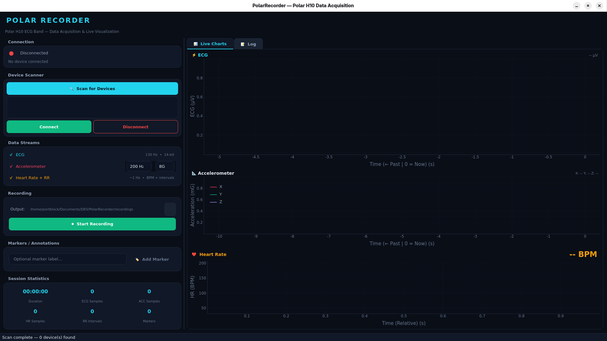

# PolarRecorder

**Professional-grade Polar H10 ECG band data acquisition & live visualization for PC.**




## Features

- **🔌 BLE Connection** — Auto-discover and connect to Polar H10 devices
- **⚡ ECG Recording** — 130 Hz, 14-bit, µV values
- **📐 Accelerometer** — 25/50/100/200 Hz, ±2/4/8G, 3-axis (mG)
- **❤️ Heart Rate & HRV** — Real-time BPM + RR intervals (ms) + **RMSSD HRV** calculation
- **📊 Live Visualization** — GPU-accelerated real-time charts (pyqtgraph)
- **🏷️ Markers** — Event markers and start/end segments (`MARKER_START`/`MARKER_STOP`, like the Android app), with keyboard shortcuts
- **🩺 Signal Health** — Live per-stream data rate, skin-contact status and strap battery level; warns when a stream stops delivering data
- **🛟 Safe Recording** — If the strap disconnects, the recording is stopped and saved automatically; data is flushed to disk every second
- **📁 Compatible Output** — CSV format matching Polar Sensor Logger (Android) for research pipelines
- **📋 Session Metadata** — JSON file with label, device info, config, statistics and why the session ended
- **🌙 Dark Theme** — Premium research-grade UI with responsive layout

## Requirements

- Python 3.12+
- Bluetooth Low Energy (BLE) adapter
- Polar H10 chest strap

## Installation

We recommend using [uv](https://github.com/astral-sh/uv) for fast dependency management:

```bash
# Clone the repository
git clone <repo-url>
cd PolarRecorder

# Install dependencies and run
uv run main.py
```

*Or using standard pip:*
```bash
python3 -m venv venv
source venv/bin/activate
pip install -r requirements.txt
python main.py
```

## 🐧 Linux / BlueZ Requirements
The Polar H10 uses `indicate` properties. On Linux/BlueZ, **you must pair the device** before starting data streams to avoid connection hangs.
1. The app will attempt to auto-pair on the first connection.
2. If it fails, pair manually via `bluetoothctl`:
   ```bash
   bluetoothctl
   scan on
   pair <DEVICE_MAC>
   trust <DEVICE_MAC>
   ```

## 🪟 Windows Requirements
The application is fully compatible with Windows 10 and 11.
1. **Bluetooth Pairing:** When you click "Connect", Windows may show a notification: *"A device wants to pair"*. You **must** click this notification and allow pairing for the data streams (ECG/ACC) to work.
2. **Privacy Settings:** Ensure "Bluetooth" access is enabled in *Windows Settings > Privacy & Security*.

## 🍎 macOS Requirements
CoreBluetooth handles pairing automatically (there is no explicit pair API), so no manual pairing is needed on first use. However, the H10 only stores a few bonded devices, so if it is later paired with another device (phone, another PC) it may drop macOS's bond while macOS still keeps it cached. Connecting then fails with:

```
CBErrorDomain Code=14 "Peer removed pairing information"
```

To clear the stale pairing:
1. Open **System Settings → Bluetooth**, click the **(i)** next to the Polar H10 and choose **Forget This Device**.
2. Toggle Bluetooth off/on, or reset the module: **Shift+Option-click** the menu bar Bluetooth icon → **Reset the Bluetooth module** (or run `sudo pkill bluetoothd`).
3. Clear the strap's own stored pairing: remove the H10 battery, wait ~10s, and reinsert it.
4. Scan and connect again in the app.

## Usage

1. **Configure** — Enable/disable ECG, ACC, HR streams and set the ACC rate/range. Settings apply when connecting, so choose them first (they are locked while connected).
2. **Scan** — Wear the strap (it sleeps without skin contact) and click "Scan for devices"
3. **Connect** — Select the device and click "Connect", or double-click it (accept any OS pairing prompt). Check that each chart shows a live rate and skin contact is good.
4. **Label** — Optionally enter a session label such as `P01 - Seat Rest`; it becomes the session folder name
5. **Record** — Click "Start recording" to begin saving data to the `./recordings` folder
6. **Annotate** — Add event markers (Enter in the label field, or Ctrl+M) and start/end segments (Ctrl+Shift+M)
7. **Stop** — Click "Stop recording" to save and finalize the session; "Open" shows it in your file manager

If the connection drops during a recording, the session is stopped and saved, with a `connection lost` marker.

## Output Format

Output files are saved to the `recordings/` directory by default, in a folder named after the session label, or `<model>_<device id>_<timestamp>` when no label is given:

```
recordings/
└── P01 - Seat Rest/                 (or Polar_H10_16E0A933_20260424_141011/)
    ├── Polar_H10_16E0A933_20260424_141011_ECG.txt
    ├── Polar_H10_16E0A933_20260424_141011_ACC.txt
    ├── Polar_H10_16E0A933_20260424_141011_HR.txt
    ├── Polar_H10_16E0A933_20260424_141011_RR.txt
    ├── MARKER_20260424_141011.txt
    └── session_metadata.json
```

### File Formats

**ECG** (semicolon-separated):
```
Phone timestamp;sensor timestamp [ns];timestamp [ms];ecg [uV]
2026-04-24T14:10:15.270;599616050941733632;0.0;8575
2026-04-24T14:10:15.277;599616050949425920;7.692288;10551
```
Every sample has its own sensor timestamp; `timestamp [ms]` is the time since the first ECG sample of the session.

**ACC** (semicolon-separated):
```
Phone timestamp;sensor timestamp [ns];X [mg];Y [mg];Z [mg]
2026-04-24T14:10:20.058;599616065136175104;-953;63;425
```

**HR** (semicolon-separated):
*Note: HRV column uses RMSSD calculated over a 30-beat rolling window.*
```
Phone timestamp;HR [bpm];HRV [ms];Breathing interval [rpm];
2026-04-24T14:10:16.752;64;42.5;;
```

**RR** (semicolon-separated):
```
Phone timestamp;RR-interval [ms]
2026-04-24T14:10:16.752;937
```

**MARKER** (semicolon-separated):
```
Phone timestamp;Marker start/stop
2026-04-24T14:10:20.031;MARKER_START 
2026-04-24T14:10:31.410;MARKER_EVENT stand up
2026-04-24T14:10:37.083;MARKER_STOP 
```

See [DATA_FORMAT.md](DATA_FORMAT.md) for details on every column.

### Comparing firmware HR with ECG

`compare_hr.py` detects R-peaks in a session's ECG and compares the resulting heart rate with the strap's own HR (with a Bland-Altman plot):

```bash
uv run compare_hr.py "recordings/P01 - Seat Rest"
```

## Architecture

```
PolarRecorder/
├── main.py                    # Entry point
├── compare_hr.py              # Firmware HR vs ECG R-peak HR analysis
├── requirements.txt           # Dependencies
├── polar_recorder/
│   ├── app.py                 # QApplication + qasync setup
│   ├── ble/
│   │   ├── scanner.py         # Device discovery (bleak)
│   │   ├── device.py          # Connection & stream management (BleakClient injection)
│   │   └── data_models.py     # Data classes for stream data
│   ├── recording/
│   │   ├── session.py         # Recording session lifecycle & HRV calc
│   │   └── writer.py          # Buffered CSV file writers
│   ├── utils/
│   │   ├── config.py          # App configuration and constants
│   │   └── rate_meter.py      # Live stream rate measurement
│   └── ui/
│       ├── main_window.py     # Main window orchestration
│       ├── connection_panel.py # Device scanner & connection UI
│       ├── recording_panel.py  # Recording controls & stats
│       ├── live_charts.py     # Real-time charts (pyqtgraph)
│       └── styles.py          # Premium Dark Theme
└── recordings/                # Local data storage (Git ignored)
```

## Technology Stack

| Component | Library | Purpose |
|-----------|---------|---------|
| BLE | `polar-python` + `bleak` | Polar H10 BLE protocol |
| GUI | `PySide6` (Qt6) | Native desktop UI |
| Charts | `pyqtgraph` | GPU-accelerated real-time plotting |
| Async | `qasync` | Bridge asyncio ↔ Qt event loop |
| Data | `numpy` | High-performance HRV calculations |

## License

MIT License — See [LICENSE](LICENSE) for details.

## Acknowledgments

- [polar-python](https://github.com/zHElEARN/polar-python) — Polar BLE protocol library
- [bleak](https://github.com/hbldh/bleak) — Cross-platform BLE library
- [Polar BLE SDK](https://github.com/polarofficial/polar-ble-sdk) — Official Polar developer resources
